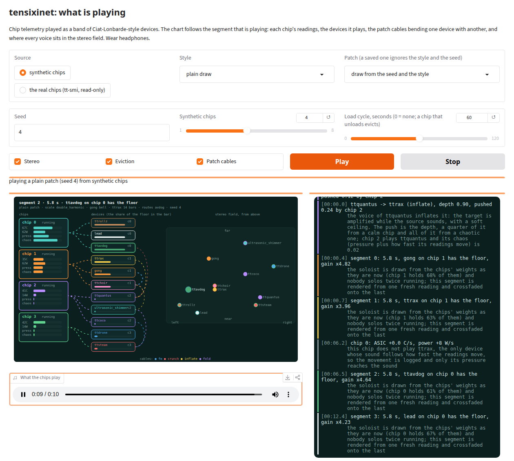
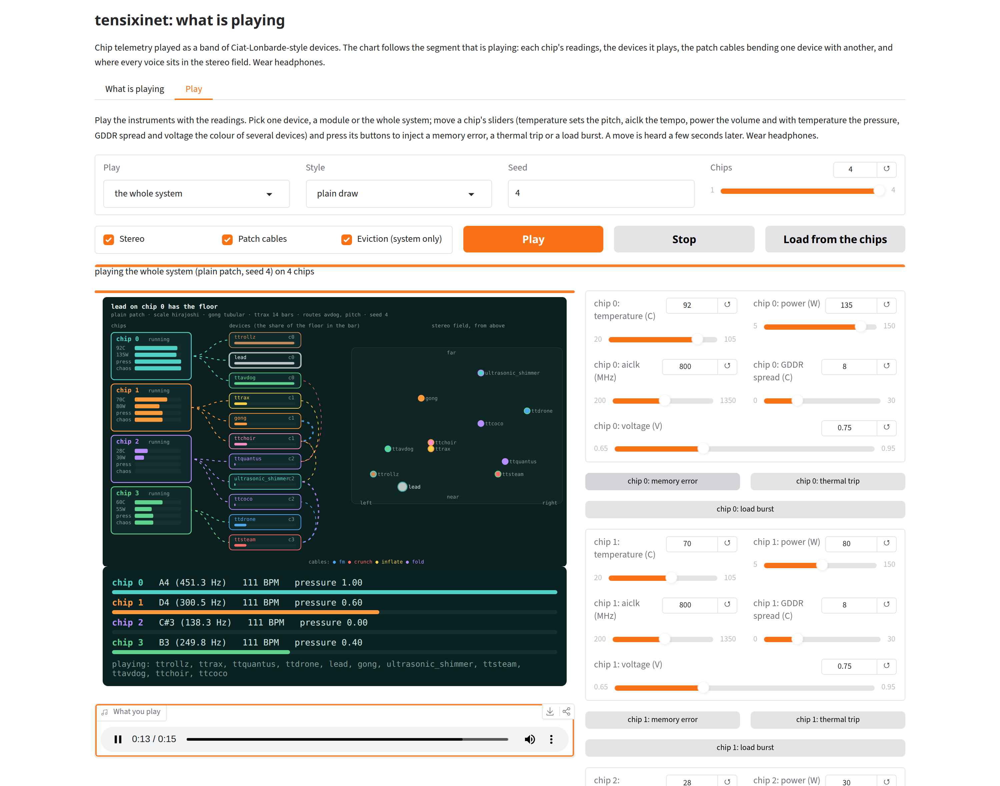

# tensixinet

**Your Tenstorrent chips, playing in a band.**

[](https://github.com/tsingletaryTT/tensixinet/actions/workflows/test.yml)
[](LICENSE)

[](demo/assets/kernels.final.mp4)

*Click the picture for the 100-second demo with sound (`demo/assets/kernels.final.mp4`, also on the
[site](https://tsingletaryTT.github.io/tensixinet/)). Left: the run log, coloured like the Ciat-Lonbarde jacks, while each of four
chips runs its own gong, shimmer, drone ripple, AVDog and delay mix as TT-Lang kernels (`--kernels chips`). Right:
[tt-toplike](https://github.com/tenstorrent/tt-toplike) watching the same chips. The soundtrack is what the chips made.*

Two earlier demos are in the repo: a 50-second one that starts from a prompt to the language model
(`demo/assets/chorus.final.mp4`), and a 2-minute one of every feature at once, with the kernel devices on the chips
(`demo/assets/features.final.mp4`). The site also has the stereo and evict recording, the style samples, a recording of a chip reset, tt-bio-demo folding proteins on all four chips with the band playing the chips, and a VCV Rack voice playing the lead's MIDI on top of tensixinet (`site/assets/voice.mp4`, in the site's "A second instrument" section).

Every chip reports its temperature, clock, power, current, memory temperatures, DDR status, harvesting and
more. tensixinet turns those readings into music. Each chip joins a small band of synthesizers inspired by
[Ciat-Lonbarde](https://pblasser.github.io/) instruments (see [Credits](#credits)), and the band trades solos. A cool chip and a hot chip
sound different, a busy chip gets more solos, and uneven memory temperatures make the melody wander.

You can prompt a local language model first. Its work heats the chips, so you can hear the model
thinking. Every choice the program makes is written to a log with the reason for it, and each run
draws a different patch, so no two runs sound alike unless you replay one.

You do not need Tenstorrent hardware to try it. It can play any number of synthetic chips. Tenstorrent hardware hardly strictly required.

**Project site:** <https://tsingletaryTT.github.io/tensixinet/> has the routing diagrams (with animated signal paths for five scenarios), the cable explorer and audio samples. Its source is in `site/`.

## Try it in a minute

```bash
git clone https://github.com/tsingletaryTT/tensixinet && cd tensixinet
./tensixinet.py --live
```

That is all. `tensixinet.py` needs Python 3.10 or newer and nothing else installed. The first run makes a `.venv` in the folder and installs
numpy and soundfile there, then plays until you press Ctrl-C. If the box has `tt-smi` it plays your chips. If it does not, it says so and plays four
synthetic chips. The sound goes to `paplay`, `aplay` or `ffplay`, whichever is installed.

| Command | Does |
|---|---|
| `./tensixinet.py --live` | Play as it goes, until Ctrl-C |
| `./tensixinet.py --app` | Open the page that draws what is playing, at http://localhost:7880 (builds `.venv-app` with Gradio the first time) |
| `./tensixinet.py --doctor` | Say what is installed: Python, numpy and soundfile, `tt-smi`, a sound player, `ffmpeg` |
| `./tensixinet.py --setup` | Build `.venv` now, without playing |
| `./tensixinet.py --rtpmidi-setup` | Download `rtpmidid` into `~/.local/share/tensixinet/rtpmidid` (nothing is installed system-wide, no sudo) so the MIDI port can reach a Mac or iPad over RTP-MIDI. `--doctor` says whether it is there |
| `./tensixinet.py --mock-chips 4 --duration 20` | Anything else goes to the command line below. This renders 20 s from four synthetic chips to `audio/` |

The log goes to `logs/` and a recording to `audio/`. If you would rather install it yourself, `pip install .` gives a `tensixinet` command
that takes the same options.

On a machine with Tenstorrent chips:

```bash
tensixinet --duration 60                                  # reads your chips with `tt-smi -s`
tensixinet "describe a hardware synth" --duration 60      # prompt a local model first
tensixinet --patch logs/patch_20261017_120000.json        # replay an earlier run's choices exactly
tensixinet --live --duration 120                          # play as it goes, reading the chips every turn
tensixinet --live --interval 100                          # read the chips every 100 ms; how soon a change is heard is under "Fast sampling"
tensixinet --live --with-tt-toplike                       # tmux: the synth and tt-toplike side by side, reading at the same rate
tensixinet --live --tui                                   # the patch layout and the log, full screen
```

Reading telemetry does not open the chips. `tt-smi -s` is read-only, so none of this needs a lease on a shared
machine, and nothing in the package imports `ttnn` (a test checks that for every file).

## Meet the band

Eleven devices, dealt out across however many chips you have. One chip plays all eleven. Eleven or more
chips play one each. Anything in between shares them.

| Device | What you hear | What drives it |
|---|---|---|
| **ttrollz** | A lopsided pulse clock, plus a ttrolzer roll for each DDR channel and each group of ethernet links. Every roll runs on its own barre's tempo, so the lanes drift against each other | temperature, clock, DDR status, ethernet links |
| **ttrax** | 4, 7 or 14 barres (Tetrax, Sidrax or Quatrax, picked by the patch), each an oscillator bouncing between two walls. A press plays a tone. A release lets the walls become other barres' oscillators and the barre glitches | temperature, clock, GDDR temperatures, ARC clock, pressure |
| **ttquantus** | A five-petal ttquantussy plays a melody that repeats and slowly drifts, through an 8-bit buffer | temperature, clock, AXI clock, chip identity |
| **ttdrone** | A drone of one to six C major voices, a little sharp or flat, that ripples after every gong strike | temperature, voltage, PCIe usage, clock, heartbeat, chip identity |
| **Lead** | An eight-note motif that gets shifted up or flipped upside down, bar by bar, and brighter near a limit | temperature, clock, GDDR temperatures, pressure, chip identity |
| **Gong** | Inharmonic strikes with slowly beating partials, a gamelan or tam-tam ring. A strike waits for the chip's clock to get through a blocking window | temperature, clock, heartbeat, chip identity |
| **Ultrasonic shimmer** | Two close tones at 12 to 20 kHz that swell and fade, swell more near a limit, and snap on every gong strike | temperature, clock, GDDR temperatures, pressure, heartbeat, chip identity |
| **ttavdog** | A droning oscillator that a ringing filter opens. A white voice sounds on one half of each swing and a red voice answers on the other half, at the same pitch with the opposite slope. The wave is a triangle at rest and skews toward a saw near a limit | temperature, clock, heartbeat, pressure, chip identity |
| **ttchoir** | A chip as a singer: a glottal buzz through a vocal tract of formant resonances, sung on "oo", "oh", "ah", "eh" and "ee". The pitch is the chip's, snapped to the patch's scale, so the chips sing in tune. Each bar reads the next GDDR channel: a hotter channel sings toward "ee", a cooler one toward "oo". The voice type comes from the chip's identity. A patch can give it a trigger source (the gong, a roll, the shift register, the looping coco, the lead or the ttrax), and then it sings syllables with consonants (s, sh, f, h, p, t, k, b, d, g, m, n) that start on that source's triggers, with no word list (a real word can only turn up by chance), and may fire a rare self-oscillating howl. Measured only; nobody has heard the consonants | temperature, clock, GDDR temperatures, pressure, chip identity, and the fields of the six trigger sources |
| **ttcoco** | The Cocoquantus's own delay chips, reimagined: eight parallel echo taps (the real instrument affords two) echoing the ttquantussy's own tone, one per GDDR channel. A hotter channel echoes faster and holds fewer bits, the real chips' own trade of delay length against resolution. Feedback is pressure | clock, GDDR temperatures, pressure, chip identity |
| **ttsteam and Snare** | A noise snare on the steps of a 14-step shift register. The steps are the chip's harvested Tensix columns, so each chip has its own rhythm of holes | clock, Tensix mask, pressure, PCIe usage |

**The devices are patched together.** The Plumbutter's patches can send one clock to several modules at once.
Here each chip's gong strikes set off the shimmer's snap
and a ripple in the drone. The gong needs a pulse from the chip's own clock after a blocking window, and the
chip's identity sets the window, so chips divide their clock differently.

**They trade solos.** Every one to four bars, one device steps forward and the others drop back. The soloist is drawn
in proportion to each chip's turn weight: its power, raised by a heavy board load, by pressure near a thermal or
power limit, and by processes using it. The busiest chip solos most. Nobody solos twice in a row, and quiet
chips still get turns.

**No two chips play alike.** Harvesting leaves every chip with different Tensix columns and ethernet links. That
fingerprint transposes a chip's lead, detunes its gong, sets how its gong divides its clock and picks which
petal its ttquantussy samples. Its harvested columns are also the steps its snare fires on.

**Trouble is audible.** Correctable memory errors tick, uncorrectable ones breathe, and a thermal trip sweeps
down. A healthy chip adds none of it. Try `--mock-chips 6 --mock-faults` to hear them.

**The lead listens to the memory.** Each bar reads the next GDDR channel and compares it with the average.
A hotter channel shifts the motif up. A cooler one inverts it. A channel near the average repeats it. Even
memory makes a loop, and uneven memory makes the melody wander.

**Power and current mix the band.** Power sets each chip's volume. Current sets its share of the mix, the
way patched banana plugs mix by current on a Plumbutter. At the end one gain brings the whole file to -18 dBFS
RMS, so every run lands at the same level and chips keep their level against each other.

## It tells you why

Every line of the log says what a reading became and the reason. This is a real run on four chips, trimmed:

```
║ [00:00.3] chip 1 plays ttrax, gong
║ [00:00.3] GDDR 46-48 C -> barre walls -0.41 to 0.41
║          why: each of the seven ttrax barres bounces between two walls: its
║               own GDDR channel sets the upper one and the next channel the
║               lower, so a hotter channel pushes a wall further out
║ [00:00.3] pressure 0.14 -> ttrax chaos 14%
║          why: how close the chip is to a limit: ASIC temperature from 40 C up
║               to the 90 C throttle point, or power from a quarter of the 125
║               W limit up to it, whichever is closer; the ttrax chaos knob
║               cross-modulates the barres, and at the top it is noise. Each
║               barre is pressed every four steps of its own ttrolzer barre, at
║               111 BPM here
║ [00:00.3] trigger response: gong strikes at 0.7, 5.0, 9.4, 14.1 s
║          why: the gong ignores its trigger for a blocking window after each
║               strike, as a Gongue does with its trigger response: two bars,
║               times 1.00 for this chip's identity. The strike lands on the
║               next pulse of the chip's own ttrollz clock after the window, so
║               a chip divides its clock its own way
║ [00:00.3] chip 3 plays ttdrone, ttsteam
║ [00:00.3] Tensix mask 0x3fdd -> snare hits on steps 1, 5 of 14
║          why: the shift register has one step per Tensix column and fires a
║               step where its column is harvested (the mask bit is 0), so each
║               chip has its own rhythm of holes
║ [00:00.3] pressure 0.29 -> snare decay 0.56 s
║ [00:00.3] PCIe usage 1 -> 15 dust pops a second
║ [00:00.3] chip 3 turn weight 123: power 40 W, board 264 W (x1.30), pressure
║           0.29 (x1.57), 1 process (x1.50)
```

The screen shows each reason once. A JSONL file in `logs/` keeps every line for programs. A test changes one
reading at a time and requires the audio to change exactly where the log says it does, so the log cannot
describe a mapping that is not in the sound.

## No two runs alike

Each run draws a **patch**: the scale, the lead's motif, the gong's tuning and beat, the shimmer band, how long
solos last and how quiet everyone else gets. The scale also sets what the ttrax barres and the ttquantus play.

- **The machine decides two things.** The scale follows how unevenly the memory channels are heated. The gong
  tuning follows the ratio of memory to ASIC temperature.
- **A seed decides the rest.** The seed hashes every reading on every chip plus the clock, so changing any one
  reading gives a new patch.
- **A patch is a small JSON file** saved next to the log. `--patch FILE` replays it and gives a byte-identical
  WAV. `--patch-seed N` fixes the seed instead.

The demo replays [`demo/chorus.patch.json`](demo/chorus.patch.json), so rebuilding it plays the same music.

## Live mode

`--live` reads the chips again every turn (one to four bars). The offline run renders one file from one reading.
Each turn is rendered from a fresh reading and played while the next one is made, so the sound is about one turn
behind the chips. A chip that heats up or draws more power changes the music within a turn or two:

* **How fast the readings move** (degrees and watts per second) turns up ttrax's chaos knob, on top of
  pressure. A cool chip that heats quickly gets as unsettled as a hot one.
* **The soloist is drawn again every turn** from the chips' current weights.
* **New errors play once.** A memory error or thermal trip that appears mid-run ticks, breathes or sweeps in
  the next turn. It does not repeat in later turns.
* **A chip that drops out, or a failed reading,** is logged. A failed reading plays the last good one again.
* **A loudness gain follows the music** so the level stays near -18 dBFS RMS while the chips change.

The sound goes to `paplay`, `aplay` or `ffplay` (whichever is installed, or pick one with `--player`), and `--out`
records what was played. `--player none` keeps time with no sound. `--duration 0` plays until Ctrl-C. Live mode reads
telemetry only, so like the offline run it needs no lease. The limits are in [docs/DECISIONS.md](docs/DECISIONS.md):
each turn restarts the devices' clocks, so a ringing gong fades at the end of its turn.

### Fast sampling: `--interval`

`--live --interval MS` reads the chips every MS milliseconds (10 to 1000, as in tt-toplike) and plays a change soon after it happens. A change that
arrives when the last phrase started more than 1 s earlier is heard within about a quarter second. A change that arrives inside that second is
heard when the second ends, so up to about 1 s later. Without `--interval` live mode is as described above.

* **Where the readings come from.** Temperature, power, voltage and current are read from the chips' Linux hwmon files, which take well under a
  millisecond. `tt-smi -s` runs on a background thread about every 1.5 s and fills in the slow fields (clocks, GDDR temperatures, errors, thermal
  trips, masks). The two are matched by PCI bus address. A hung `tt-smi` does not stop the sound. If hwmon is missing or cannot be matched, the run
  continues at `tt-smi`'s pace and the log says so and makes no quarter-second claim. A chip whose hwmon reads start failing (after a reset, for
  example) is logged; after ten failures in a row the chips are searched for again, and until the chip reads again its values come from `tt-smi`.
* **How it plays.** Each block (the interval, but at least 100 ms) reads the latest values. A move past a threshold starts a 1 s phrase, rendered
  first as a 0.6 s head that plays at once while the rest renders in the background. A change starts a phrase at most once a second, and a change
  that lands inside that second waits for it to end. On the four real chips the readings cross the thresholds often enough that a phrase starts
  about every second, so most changes wait. A new phrase restarts every device's clock, the gong and the rolls included. While the readings keep
  moving, the gong and the rolls therefore restart about once a second, and in about half of the chip and patch draws the gong has no strike in its
  first second. A quiet stretch plays 6 s phrases, which let them play out. Keeping the rolls on their own schedule needs a phrase that continues
  from where the last one was (`docs/ROADMAP.md`, item 7d). Errors, thermal trips and mask changes arrive with the `tt-smi` reading, about every
  1.5 s, and are outside the quarter-second budget.
* **Sample rate.** The default with `--interval` is 22050 Hz, because a head renders in about 75 to 90 ms at that rate and a block is 100 ms.
  `--sample-rate 44100` gives the fuller rate and misses the budget.
* **The log reports its own delay.** Every 5 s a `delay` line gives the worst delay since the last report (the interval, plus render time, queued
  audio, the player's buffer and any wait for the one-second gap between phrases) and the typical one, and says when it is over 250 ms. The run
  calculates these from its own timings and the player buffer it asked for. The delay at the speaker has not been measured: the run cannot see the
  sound server's own latency or audio waiting in the pipe to the player. `paplay` is asked for a 20 ms buffer. `--player auto` picks `paplay`
  first. `ffplay`'s buffer is an estimate (100 ms) and puts the delay over the budget.
* **Calculated by the run** (four real chips, read-only, `--interval 100`, 22050 Hz, `paplay`): worst case 220 ms and typical 170 ms for a change
  that arrives when the last phrase started more than 1 s earlier, and no gaps in the sound over 30 s. These runs were logged before the `delay` line
  counted the wait for the gap. A change inside the gap is heard when it ends, so up to about 1 s plus that delay. At 44100 Hz the worst case was
  about 420 ms and the typical about 320 ms. None of it has been heard by a person.
* `--interval` needs `--live` and cannot be used with `--kernels`. With `--mock-chips` the synthetic chips are read at the same rate. In fast mode
  `--only` turns eviction off, and the log says so. Live mode without `--interval` still follows and logs evictions with `--only`, and the soloed
  devices do not fade.

### Side by side with tt-toplike: `--with-tt-toplike`

```bash
tensixinet --live --with-tt-toplike                          # both read every 100 ms
tensixinet --live --with-tt-toplike --interval 50 --toplike-args "--mode arcade"
```

This starts a tmux session named `tensixinet` with the synth in the left pane and tt-toplike in the right, both at the same `--interval` (100 ms when it
is not given). Outside tmux the session runs on its own tmux socket (`tmux -L tensixinet attach -t tensixinet`) with the config in
`tensixinet/media/tmux-toplike.conf`: no status bar and full 24-bit colour, the same settings tt-demo-maker records with. Your own `~/.tmux.conf` is not read
there, so your key bindings and prefix do not apply in this session. Inside tmux it splits the current window and leaves your own pane and your own config (with `--tui` it opens a new window for the two panes). Ctrl-C in the synth pane ends both, and so does quitting tt-toplike.
If the synth ends with an error, its pane waits for Enter so the message can be read. `--toplike-args` passes extra arguments to tt-toplike as one quoted
string. It needs `--live`, tmux and tt-toplike on the PATH, and is refused with `--mock-chips` or `--kernels`. Nothing here opens `/dev/tenstorrent/*`,
so it needs no gozer lease.

**The command line no longer accepts abbreviated flags** (`--dur 30` was `--duration 30`). An abbreviated `--with-tt-toplike` would start sessions
without end, because the synth pane would start another. A `TENSIXINET_IN_SESSION` variable also stops a synth pane from starting a session.

### Full screen: `--tui`

```bash
tensixinet --live --tui --mock-chips 4         # try it with no hardware
tensixinet --live --tui --player none          # on your chips, with the picture exactly on time (no sound)
tensixinet --live --tui --interval 100         # fast mode, one frame per phrase
tensixinet --live --with-tt-toplike --tui      # the synth pane shows it, tt-toplike beside it
```

`--tui` replaces the scrolling log with one full-screen picture of what is playing, drawn as the music plays. Each chip has a readings line (phase,
temperature, power, pressure and the devices it drives), under a READINGS heading when there is a spare row. The devices are grouped by the role they play: RHYTHM, MELODY, AIR and MOD/DELAY. Each device
shows which chip plays it and a four-cell bar for its share of the mix. The soloist and its chip are bold and the rest are dimmed, and the chip marks of each column line up. Below them are
the five strongest cables as `source ═kind depth═▶ target` lines, a stereo line that places each device's two-letter code from left to right (`ld` is the lead, `rz` ttrollz; a legend
under the line lists them when there is a spare row), and the run log, built
into the same screen with the same jack colours, chip colours and device colours as the plain log. The picture is made from the same data as the
Gradio page's flow chart (`FlowState`), so the two cannot disagree. It is made for 80 by 24 and redraws at most 10 times a second, changing only the cells that differ.
At 24 rows or fewer it lists three cables, so the log has at least six rows for the reasons under each line.
A frame with nothing new is not drawn again, and the whole screen is redrawn every 5 s (or on Ctrl-L), so a warning written over it does not stay.

`q` and Ctrl-C both end the run the same way. The heading says at once that the run is stopping, the segments already made play out, and a second `q` or
Ctrl-C stops at once. With `--tui` the player runs in its own session, so a Ctrl-C reaches only the run and not the player. On the way out the screen returns to normal and the last lines are printed, and the plain log still goes
to the `.txt` file and the JSONL as before. `NO_COLOR` and `--color` are respected. `--tui` needs a terminal: with its output going to a pipe or a file it is refused.

Limits, as measured so far:

* Below 60 columns or 16 rows the screen is one line saying it is too small. A chip that is evicting or idle is drawn at one of three dimmer levels. The log pane keeps the newest 400 records.
* In plain `--live` the run does not know how much sound the player has buffered, so with a real player the picture can run ahead of the sound.
  `--player none` keeps exact time. In fast mode the run asks the player for a small buffer and counts it.
* After `q` the run plays the segments it has already made, so it can take several seconds to end; the heading says so while it does.
* In fast mode on the four real chips (`--interval 100 --player none`, 30 s runs, two with `--tui` and two without), the run's own delay report counted
  0 gaps in the sound in every run.
* In fast mode (`--interval`) the line saying who has the floor appears one phrase late, and the log has no howl lines or per-segment choir lines.
* `--with-tt-toplike --tui` inside your own tmux opens a new window named `tensixinet`, with the synth and tt-toplike side by side, each half its width; your
  own pane is left as it was, and the window closes when the run ends. Without `--tui` it splits your current window, as before. Outside tmux there are two panes.
* A module's cable hint names the device at the other end of the cable. It does not name that device's chip, so with 12 or more chips (where a device is
  dealt to two chips) it does not say which one.
* The design mock for this screen also draws trigger lamps and output waves. The screen does not, because the flow data has neither.
* Nobody has watched it for long. It was measured on pseudo-terminals and in tmux at 80 by 24 and 60 by 16, with synthetic chips and with the four real chips in fast mode.

## The Cocoquantus as an effects unit

Beyond its own voices (`ttquantus` and `ttcoco`), the Cocoquantus takes the rest of the band as its audio input, as the real one does: each chip's voices are sent through four
crunchy 8-bit delay taps whose echo times the petals' castles sway, then through a room. A patch sets how much is sent and how big the room is (`docs/SOUND.md`, "The coco bus").

## See what is playing



`app/gradio_app.py` is a Gradio page that draws the music as it plays and does not change it. Each chip shows its temperature, power, pressure and
chaos and is wired to the devices it plays. A device carries a bar for its share of the floor. The patch cables arc between devices, thicker the
harder they push. The stereo field shows every voice at its azimuth and depth, and a chip that is evicting fades its voices. The run log is beside it,
coloured by jack. You pick the source (synthetic chips, with an optional load cycle so a chip unloads, or the real chips read with `tt-smi`), a style
or a saved `*.patch.json`, and a seed. It needs no gozer lease.

Play starts a session. While it plays, changing any setting plays again with the change, and a change that leaves the settings as they were does nothing. Stop ends it,
empties the chart and stops the audio at once. Pressing Stop while a session is still starting also stops it.

Each person with the page open has their own session: one person's Play, Stop and changes do not touch anyone else's. Every session runs a render thread (and chip workers in the
simulator mode), so only `TENSIXINET_MAX_PLAYERS` people (default 3) can be playing at once. The next person to press Play is told the places are taken, and a place is free again when someone presses Stop or closes the page.

The page's audio player is kept about ten seconds ahead (`PREROLL_S` in `ui/session.py`), so it does not run dry between segments. That puts the sound ten seconds behind the chips;
the chart and the log follow the sound, and change segment when you reach it.

Before the first segment plays, the chart area shows the steps of the start with the time each has taken: start the TT-Lang simulator (when you chose it; about 15 s on a laptop,
more on a small machine such as a Space), render the first segment, and fill the buffer (a real bar, against the ten-second lead). The log says when the simulator starts and when it is ready.

```bash
./tensixinet.py --app                         # http://localhost:7880; builds .venv-app the first time
# or by hand:
uv venv .venv-app && uv pip install --python .venv-app/bin/python "gradio>=5" numpy soundfile -e .
.venv-app/bin/python app/gradio_app.py
```

It is also a [tt-discolike](https://github.com/tsingletaryTT/tt-discolike) app (`.disco/app.yaml`), so the catalog can start and stop it. The chart,
the log panel, the session and the Play tab's knobs, scopes, instrument and readout are in `tensixinet/ui/` and are tested without Gradio.

## Play it



The second tab of the page, **Play**, is the instrument. You choose what to play: one device, a module (a named group of devices: the rhythm section,
drones and air, melody, delay and echo) or the whole system with its cables, delay bus and eviction. Then you play it with the readings. Each chip has
sliders for temperature, power, aiclk, GDDR spread and voltage, and three buttons that inject a memory error, a thermal trip or a load burst (a chip's
power jumps by 70 W for four seconds, so an eviction can follow). Temperature moves the pitch, aiclk the tempo, power the volume, and temperature with
power the pressure that brightens, thickens and speeds several devices. A slider that moves fast gives a chip a temperature or power rate, which moves the
ttrax chaos as it does when a real chip heats quickly. On a machine with `tt-smi`, **Load from the chips** copies one real reading into the sliders.

A move is heard about four seconds later: the page keeps its audio player three seconds ahead, because on less it stalls. Above the sliders the Play tab draws the same flow chart as the first tab for the
block you are hearing: each chip's temperature, power, pressure and chaos, the devices dealt to it, the cables, who has the floor and the stereo field, so a slider's effect on
the system is seen as it is heard. A device outside the chosen scope is drawn faint. Under the chart, the readout shows each chip's pitch, tempo and pressure. Moving a slider or pressing a button never restarts the sound; changing the thing played, the
style, the seed, the chip count or a switch does. Playing in either tab ends what you were playing in the other, and a visitor counts as one player for
`TENSIXINET_MAX_PLAYERS` whichever tab they use. The Play tab runs on the CPU with synthetic chips only.

The sound is made in short phrases, because the slow devices need room: the gong's first strike can be two seconds in. A move starts a short phrase
(2.4 s) so it is heard quickly, and a phrase that runs out with nothing moving is followed by a long one (6 s). A new phrase takes over with a 0.2 s
crossfade. Each phrase restarts the devices' clocks, so a ringing gong fades at the join, as in live mode.

## What the readings do

| Reading | Becomes | Range |
|---|---|---|
| ASIC temperature | Pitch, linear in semitones | 25-100 °C is C3 to C5 |
| AI clock | Tempo | 400-1350 MHz is 60-180 BPM |
| Power | Chip volume, exponential curve | 0-200 W is 0.3 to 1.0 |
| Current | Share of the mix | each chip's fraction of the total |
| GDDR temperatures | ttrax walls, the lead's shifts and flips, the shimmer's beat | every channel the board reports |
| DDR status | ttrollz rolls of 3, 4, 5 and 6 sides; status 0 grounds a roll | 4 fields |
| Voltage | Drone detune, 4 cents per 10 mV | 0.70-0.90 V is -20 to +60 cents, capped at 40 |
| PCIe usage | Drone voices, and the snare's dust | 1 to 6 |
| ARC clock, AXI clock | ttrax pitch, ttquantus hold rate and buffer clock | 1.0 at 800 and 960 MHz |
| Ethernet links | Four slow ttrollz rolls, loud in proportion to the links up in each group of four | 16 links |
| Tensix and ethernet masks | Chip identity: lead transpose, gong detune and trigger response, ttquantus castle. The harvested Tensix columns are the snare's steps | per chip |
| Heartbeat | Where the gong starts in its first blocking window | counter mod 16 |
| Pressure | Lead overtone, shimmer level, ttrax chaos, snare decay, turn weight | 0-1, from the throttle temperature and the power limit |
| Board power, processes using the chip | Turn weight | |
| Memory errors, thermal trips | Ticks, breaths and sweeps | counts |

The full reasoning is in [docs/SOUND.md](docs/SOUND.md). One detail matters for correctness: a GDDR channel's
temperature is the hotter of its two dies, because `tt-smi` packs two channels with two dies each into every
register. The first prototype read those bytes as independent sensors and lost half the channels.

## Options

| Option | What it does |
|---|---|
| `PROMPT` | Send this to the language model first, so its load is on the chips when they are read |
| `--duration SECONDS` | Length of the audio (default 60). With `--live`, 0 plays until Ctrl-C |
| `--sample-rate HZ` | Default 44100 (22050 with `--interval`). Use 96000 for more ultrasonic headroom |
| `--mock-chips N` | Play N synthetic chips and read no hardware. `--seed` varies them |
| `--mock-faults` | With `--mock-chips`, give some chips memory errors and thermal trips so the event sounds play |
| `--patch FILE` / `--patch-seed N` | Replay a saved patch, or draw from a fixed seed |
| `--live` | Read the chips every turn and play as it goes (see [Live mode](#live-mode)) |
| `--interval MS` | With `--live`: read the chips every MS ms, 10 to 1000 (blocks are at least 100 ms). See [Fast sampling](#fast-sampling---interval) |
| `--with-tt-toplike` | With `--live`: start a tmux session with the synth and tt-toplike at the same `--interval` (100 ms by default) |
| `--toplike-args ARGS` | With `--with-tt-toplike`: extra arguments for tt-toplike, as one quoted string |
| `--tui` | With `--live`: draw the chips, the devices by role, who has the floor, the strongest cables, the stereo field and the log full screen; `q` or Ctrl-C ends the run. See [Full screen](#full-screen---tui) |
| `--player NAME` | With `--live`: `auto` (the default), `none`, `paplay`, `aplay` or `ffplay` |
| `--only DEVICES` | Audition: play only these devices (comma separated, for example `--only ttchoir,ttavdog`). The others are silent and there is no turn-taking, so you hear each device as it is |
| `--kernels [MODE]` | Run the devices that have TT-Lang kernels (the gong, shimmer, drone ripple, AVDog, ttcoco mix, the choir's harmonics and the mixer) on chips. `chip` (the default when no mode is given) takes a gozer lease on one board, `chips` on as many chips as the run plays with each chip's devices on that chip, `host` runs the same kernels' formulas in numpy with no chip, `sim` runs the kernels themselves in the TT-Lang simulator (needs `tt-lang-sim`; set `TT_LANG_SIM` if it is not on the path). The rest of the band stays on the CPU. See [kernels/README.md](kernels/README.md) |
| `--style NAME` | Draw the patch in a style: `chiptune`, `enya`, `blues` or `aphex`. A style narrows the scales, gong tunings, motif and turn length and sets the band's balance. The system and the seed still decide the rest, so no two runs match |
| `--color MODE` | `auto` (the default) colours a terminal with the Ciat-Lonbarde jack colours unless `NO_COLOR` is set, `always` colours a recording that is not a terminal, `never` turns it off. The text log and the JSONL are never coloured |
| `--mono` | One channel, the sound as it was before stereo. By default every voice is placed in a stereo field: a home for each chip, an offset for each device, an orbit that follows the chip's chaos and clock, depth, and movements from inside the devices (see [docs/SOUND.md](docs/SOUND.md#stereo-a-field-and-not-a-pair)) |
| `--mock-load SECONDS` | With `--mock-chips` and `--live`: take each synthetic chip round a load cycle of this many seconds (rest, a load, rest, the chips staggered) so a chip unloads and the eviction can be heard without a model |
| `--no-evict` | In live mode, do not dissolve a chip's voices when its model unloads ([Evict](docs/SOUND.md#evict-when-a-chips-model-unloads)) |
| `--midi-file PATH` | Also write the devices' notes, drum triggers and controllers as a Standard MIDI File, one track per chip. The audio is unchanged. Example: `./tensixinet.py --mock-chips 4 --duration 30 --midi-file out.mid`. See [docs/MIDI.md](docs/MIDI.md) |
| `--midi-port NAME` | With `--live`: play the same events on a live MIDI output (`virtual` makes one called `tensixinet`). Needs `pip install -e .[midi]`. Example: `./tensixinet.py --live --midi-port virtual`. Not yet heard through a real synth |
| `--midi-offset-ms MS` | With `--midi-port`: send every message this many milliseconds later (negative is earlier) to line it up with the sound. Never measured against real audio |
| `--midi-map FILE` | A JSON file that changes the MIDI channels, drum notes and controller numbers. Needs `--midi-file` or `--midi-port` |
| `--no-banner` | Start with the first log line instead of the opening art and the colour legend |
| `--no-cables` | Leave out the patch cables. By default five to eight cables, drawn from the patch seed, let one device's sound bend (`fm`), crunch, swell or fold another's, driven harder by chips under pressure |
| `--no-eq` | Leave the final mix unshaped. By default an EQ lifts the lows (70 to 250 Hz, up to +4 dB), cuts rumble below 35 Hz and takes the shimmer down (-14 dB at 14 kHz, -33 dB at 20 kHz) |
| `--no-normalise` | Keep the level the chips' power gives. By default one gain brings the render (or, live, each turn) toward -18 dBFS RMS |
| `--out`, `--log-dir` | Where the WAV and the log go (`audio/`, `logs/`) |
| `--endpoint`, `--model` | Any OpenAI-compatible endpoint (default `http://127.0.0.1:8011`). The model name is read from it |

**Send the MIDI to a Mac or iPad (RTP-MIDI).** The `--midi-port virtual` port is an ordinary ALSA port, so `rtpmidid` carries it over Apple's network MIDI. `./tensixinet.py --rtpmidi-setup` gets it and prints the steps; the Mac picks the session in Audio MIDI Setup, Network. Tried between two `rtpmidid` instances on one machine (the lead's notes, bends and the gong's triggers arrived); not tried with Apple's driver or over a real network. Details: [docs/MIDI.md](docs/MIDI.md#over-the-network-rtpmidi-tried-with-rtpmidid).

**Play a second instrument on top** (a two-minute recording of this is in `site/assets/voice.mp4` and on the site). `vcv/tensixinet-voice.vcv` is a VCV Rack (Free) patch with one monophonic voice, a dark low-pass filter and a lot of resonance, that plays the lead's MIDI channel.
Start `./tensixinet.py --live --midi-port virtual`, open the patch in Rack and pick the `tensixinet` MIDI input. `demo/vcv_record.sh` records the pair (tensixinet's log, its MIDI and Rack, with sound) on a private display. Steps, what was measured and what was not are in [docs/MIDI.md](docs/MIDI.md#a-voice-on-top-in-vcv-rack).

If the endpoint is down, the music still plays and the log says so.

## How it is built

```
 prompt ─► media/llm            tt-smi -s ─► telemetry/snapshot    --mock-chips ─► telemetry/mock
                                                      │                                  │
                                                      └──────────── one reading per chip ┘
                                                                          │
                                         ┌────────────────────────────────┴───────────┐
                                         ▼                                            ▼
                                 music/  patch ► devices ► turns ► chorus     narrate/  explain ► runlog
                                         │                                            │
                                         ▼                                            ▼
                                       WAV  ──► media/mux ──► video soundtrack      JSONL + text log
```

| Folder | Job |
|---|---|
| `tensixinet/telemetry/` | `tt-smi -s` parsing for any chip count, hwmon readings, the fast source that merges the two, and synthetic chips |
| `tensixinet/music/` | The mapping table, the eleven devices, patches, turn-taking, the mixer, and live mode's segment joins |
| `tensixinet/score/` | The notes, triggers and controls the devices play, as data, the MIDI file and live port they go to, and the VCV Rack voice patch in `vcv/` ([docs/MIDI.md](docs/MIDI.md)) |
| `tensixinet/live.py` | The live loop: read, render a turn, play it while the next is made |
| `tensixinet/fast.py` | The fast loop for `--interval`: read hwmon every block, play phrases from the Play tab's engine, report the delay |
| `tensixinet/narrate/` | The what-and-why log |
| `tensixinet/tui/` | The `--tui` screen: `layout.py` and `frame.py` turn the flow data into a grid of styled cells, `logpane.py` wraps and colours the log, `playhead.py` times what is shown to what is heard, `app.py` owns the terminal. Standard library only |
| `tensixinet/media/` | The language model client, the ffmpeg soundtrack step, and the players live mode sends sound to, and the tmux session for `--with-tt-toplike` |
| `tests/` | One test file per module, in a folder that matches the module's |
| `demo/` | The [tt-demo-maker](https://github.com/tsingletaryTT/tt-demo-maker) manifest and scripts that record the video |
| `docs/` | [Architecture](docs/ARCHITECTURE.md), [sound design](docs/SOUND.md), [what the instrument guides say](docs/CIRCUITS.md), [decisions](docs/DECISIONS.md), [contributing](docs/CONTRIBUTING.md), [roadmap](docs/ROADMAP.md), [MIDI out](docs/MIDI.md) |
| `legacy/` | The first prototype. Some scripts open the device; see its README |

## Tested without hardware

```bash
make test        # about 90 s, no Tenstorrent packages, no chips
```

Some tests skip when what they need is missing: the simulator tests skip without `TT_LANG_SIM`, the `tt-smi` comparison test skips without
`tt_smi.utils`, and the app's tests skip without Gradio (`.venv-app/bin/python -m pytest` runs them).

The tests are written first, then the code is broken on purpose (swap a `min` for a `max`, drop a term, stop
passing a value down) to check that a test goes red. Every mutant that survived got a new test. A hygiene test
reads every source file and fails on any import that would open a device, a folder without `__init__.py`,
a module without a test file, or a missing license header.

To rebuild the demo you need [tt-demo-maker](https://github.com/tsingletaryTT/tt-demo-maker), tt-toplike and
ffmpeg: `make demo`.

## Status

The instrument works and is still growing.

- **Done:** reading any number of chips, eleven devices (ten inspired by the instrument guides, and a choir), turn-taking, patches, the log, the demo, the `tt-smi` readings beyond temperature, clock and power (limits, harvesting, links, errors, processes) shaping the sound, and a live mode that reads the chips every turn.
- **Not done:** a live mode whose devices keep their phases and ringing gongs across turns (each turn restarts them), a patch that re-draws as the readings drift, and the TT-Lang kernels
  in [`legacy/`](legacy/README.md), which are sketches that have never run on hardware.
- **Next:** [docs/ROADMAP.md](docs/ROADMAP.md) lists what is open, in order. Contributions are welcome. Start
  with [CLAUDE.md](CLAUDE.md) and [docs/CONTRIBUTING.md](docs/CONTRIBUTING.md), which apply to people and to
  coding agents alike.

## Credits

tensixinet is inspired by the instruments of [Ciat-Lonbarde](https://pblasser.github.io/), Peter Blasser's
workshop (the instruments are sold by [Patch Point](https://patch-point.com/), and Blasser's own page links the old manuals), and owes them its ideas. It is not a recreation of them and does not simulate their circuits. The devices carry
a `tt` prefix to say so: ttrollz and ttrolzer follow the Plumbutter and Rolzer, ttrax the Sidrax, ttquantus and
ttquantussy the Cocoquantus and its Quantussy, ttsteam the Man With The Red Steam, and tthorn (not built yet) would follow the
Deerhorn. The behaviour comes from three guides by Josh Singer (the Sidrax Guide, the Cocoquantus Tasting Guide and the
Plumbutter & Rolzer Dance Party Guide). [docs/CIRCUITS.md](docs/CIRCUITS.md) says what each guide describes and which parts
the code takes from it. Please buy and play the real instruments. Telemetry comes from [tt-smi](https://github.com/tenstorrent/tt-smi), and the
demo uses [tt-toplike](https://github.com/tenstorrent/tt-toplike).

The choir has influences of its own. Its consonants were inspired by the
[ERD/WORM](https://modulargrid.net/e/erd-erd-worm-populus-edition), a Eurorack speech module from ERD Modular that bends emulated
speech chips of the 1970s to the 1990s (facts from its [ModularGrid](https://modulargrid.net/e/erd-erd-worm-populus-edition) and
[Perfect Circuit](https://www.perfectcircuit.com/erd-modular-erd-worm-populus-edition.html) listings). The ERD/WORM is a separate design by
a different maker, and nothing is copied from it. The other influence is the Speak & Spell, Texas Instruments' talking toy of 1978: its
TMS5100 chip was the first single chip to generate speech with linear predictive coding, and Richard Wiggins, Paul Breedlove, Larry
Brantingham and Gene Frantz led the team
([IEEE Milestone](https://ethw.org/Milestones:Speak_&_Spell,_the_First_Use_of_a_Digital_Signal_Processing_IC_for_Speech_Generation,_1978)).
Behind it is the research on linear prediction by Fumitada Itakura and Shuzo Saito at NTT and by Bishnu Atal and Manfred Schroeder at
Bell Labs in 1966 and 1967 (Atal's "The history of linear prediction", IEEE Signal Processing Magazine, 2006). `ttchoir` does not use
linear prediction; it is formant synthesis.

## License

Apache License 2.0. See [LICENSE](LICENSE) and [LICENSE_understanding.txt](LICENSE_understanding.txt).
Source files carry an SPDX header (`Apache-2.0`, copyright Tenstorrent USA, Inc.).
