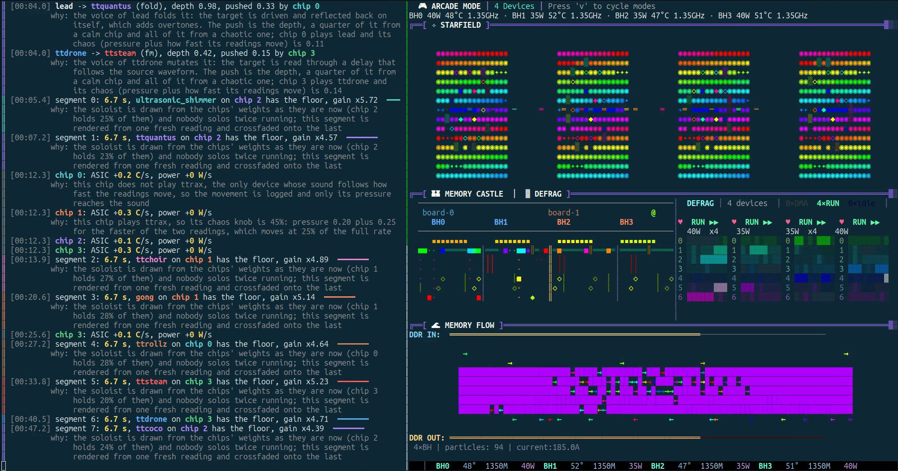

# tensixinet

**Your Tenstorrent chips, playing in a band.**

[](https://github.com/tsingletaryTT/tensixinet/actions/workflows/test.yml)
[](LICENSE)

[](demo/assets/chorus.final.mp4)

*Click the picture for the 50-second demo with sound (`demo/assets/chorus.final.mp4`). Left: the prompt
and the run log. Right: [tt-toplike](https://github.com/tenstorrent/tt-toplike) watching the same chips.
The soundtrack is what the chips played.*

Every chip reports its temperature, clock, power, current, memory temperatures, DDR status, harvesting and
more. tensixinet turns those readings into music. Each chip joins a small band of synthesizers inspired by
[Ciat-Lonbarde](https://www.ciat-lonbarde.net/) instruments, and the band trades solos. A cool chip and a hot chip
sound different, a busy chip gets more solos, and uneven memory temperatures make the melody wander.

You can prompt a local language model first. Its work heats the chips, so you can hear the model
thinking. Every choice the program makes is written to a log with the reason for it, and each run
draws a different patch, so no two runs sound alike unless you replay one.

You do not need Tenstorrent hardware to try it. It can play any number of synthetic chips.

## Try it in a minute

```bash
git clone https://github.com/tsingletaryTT/tensixinet && cd tensixinet
pip install .                                  # numpy and soundfile
tensixinet --mock-chips 4 --duration 20        # four synthetic chips, no hardware
```

It writes a WAV file to `audio/` and the run log to `logs/`. Play the WAV with anything.

On a machine with Tenstorrent chips:

```bash
tensixinet --duration 60                                  # reads your chips with `tt-smi -s`
tensixinet "describe a hardware synth" --duration 60      # prompt a local model first
tensixinet --patch logs/patch_20261017_120000.json        # replay an earlier run's choices exactly
```

Reading telemetry does not open the chips. `tt-smi -s` is read-only, so none of this needs a lease on a shared
machine, and nothing in the package imports `ttnn` (a test checks that for every file).

## Meet the band

Eight devices, dealt out across however many chips you have. One chip plays all eight. Eight or more
chips play one each. Anything in between shares them.

| Device | What you hear | What drives it |
|---|---|---|
| **Rollz** | A lopsided pulse clock, plus a Rolzer roll for each DDR channel and each group of ethernet links. Every roll runs on its own barre's tempo, so the lanes drift against each other | temperature, clock, DDR status, ethernet links |
| **Sidrax** | Seven barres, each an oscillator bouncing between two walls. A press plays a tone. A release lets the walls become other barres' oscillators and the barre glitches | temperature, clock, GDDR temperatures, ARC clock, pressure |
| **Cocoquantus** | A five-petal Quantussy plays a melody that repeats and slowly drifts, through an 8-bit buffer | temperature, clock, AXI clock, chip identity |
| **Plumbutter drone** | A drone of one to six C major voices, a little sharp or flat, that ripples after every gong strike | temperature, voltage, PCIe usage, clock, heartbeat, chip identity |
| **Lead** | An eight-note motif that gets shifted up or flipped upside down, bar by bar, and brighter near a limit | temperature, clock, GDDR temperatures, pressure, chip identity |
| **Gong** | Inharmonic strikes with slowly beating partials, a gamelan or tam-tam ring. A strike waits for the chip's clock to get through a blocking window | temperature, clock, heartbeat, chip identity |
| **Ultrasonic shimmer** | Two close tones at 12 to 20 kHz that swell and fade, swell more near a limit, and snap on every gong strike | temperature, clock, GDDR temperatures, pressure, heartbeat, chip identity |
| **MWTRS and Snare** | A noise snare on the steps of a 14-step shift register. The steps are the chip's harvested Tensix columns, so each chip has its own rhythm of holes | clock, Tensix mask, pressure, PCIe usage |

**The devices are patched together, like the real instruments.** A Plumbutter patch can send one clock to
the Ultrasound, the Gongue and the AVDog at once. Here each chip's gong strikes set off the shimmer's snap
and a ripple in the drone. The gong needs a pulse from the chip's own clock after a blocking window, and the
chip's identity sets the window, so chips divide their clock differently.

**They trade solos.** Every one to four bars, one device steps forward and the others drop back. The soloist is drawn
in proportion to each chip's turn weight: its power, raised by a heavy board load, by pressure near a thermal or
power limit, and by processes using it. The busiest chip solos most. Nobody solos twice in a row, and quiet
chips still get turns.

**No two chips play alike.** Harvesting leaves every chip with different Tensix columns and ethernet links. That
fingerprint transposes a chip's lead, detunes its gong, sets how its gong divides its clock and picks which
petal its Quantussy samples. Its harvested columns are also the steps its snare fires on.

**Trouble is audible.** Correctable memory errors tick, uncorrectable ones breathe, and a thermal trip sweeps
down. A healthy chip adds none of it. Try `--mock-chips 6 --mock-faults` to hear them.

**The lead listens to the memory.** Each bar reads the next GDDR channel and compares it with the average.
A hotter channel shifts the motif up. A cooler one inverts it. A channel near the average repeats it. Even
memory makes a loop, and uneven memory makes the melody wander.

**Power and current mix the band.** Power sets each chip's volume. Current sets its share of the mix, the
way patched banana plugs mix by current on a Plumbutter.

## It tells you why

Every line of the log says what a reading became and the reason. This is a real run on four chips, trimmed:

```
║ [00:00.3] chip 1 plays sidrax, gong
║ [00:00.3] GDDR 46-48 C -> barre walls -0.41 to 0.41
║          why: each of the seven Sidrax barres bounces between two walls: its
║               own GDDR channel sets the upper one and the next channel the
║               lower, so a hotter channel pushes a wall further out
║ [00:00.3] pressure 0.14 -> Sidrax chaos 14%
║          why: how close the chip is to a limit: ASIC temperature from 40 C up
║               to the 90 C throttle point, or power from a quarter of the 125
║               W limit up to it, whichever is closer; the Sidrax chaos knob
║               cross-modulates the barres, and at the top it is noise. Each
║               barre is pressed every four steps of its own Rolzer barre, at
║               111 BPM here
║ [00:00.3] trigger response: gong strikes at 0.7, 5.0, 9.4, 14.1 s
║          why: the Gongue ignores its trigger for a blocking window after each
║               strike: two bars, times 1.00 for this chip's identity. The
║               strike lands on the next pulse of the chip's own rollz clock
║               after the window, so a chip divides its clock its own way
║ [00:00.3] chip 3 plays plumbutter_drone, mwtrs
║ [00:00.3] Tensix mask 0x3fdd -> snare hits on steps 1, 5 of 14
║          why: the shift register has one step per Tensix column and fires a
║               step where its column is harvested (the mask bit is 0), so each
║               chip has its own rhythm of holes
║ [00:00.3] pressure 0.29 -> snare decay 0.56 s
║ [00:00.3] PCIe usage 1 -> 15 dust pops a second
║ [00:00.3] chip 3 turn weight 123: power 40 W, board 264 W (x1.30), pressure
║           0.29 (x1.57), 1 process (x1.50)
```

The screen shows each reason once. A JSONL file in `logs/` keeps every line for programs. A test changes one
reading at a time and requires the audio to change exactly where the log says it does, so the log cannot
describe a mapping that is not in the sound.

## No two runs alike

Each run draws a **patch**: the scale, the lead's motif, the gong's tuning and beat, the shimmer band, how long
solos last and how quiet everyone else gets. The scale also sets what the Sidrax barres and the Cocoquantus play.

- **The machine decides two things.** The scale follows how unevenly the memory channels are heated. The gong
  tuning follows the ratio of memory to ASIC temperature.
- **A seed decides the rest.** The seed hashes every reading on every chip plus the clock, so changing any one
  reading gives a new patch.
- **A patch is a small JSON file** saved next to the log. `--patch FILE` replays it and gives a byte-identical
  WAV. `--patch-seed N` fixes the seed instead.

The demo replays [`demo/chorus.patch.json`](demo/chorus.patch.json), so rebuilding it plays the same music.

## What the readings do

| Reading | Becomes | Range |
|---|---|---|
| ASIC temperature | Pitch, linear in semitones | 25-100 °C is C3 to C5 |
| AI clock | Tempo | 400-1350 MHz is 60-180 BPM |
| Power | Chip volume, exponential curve | 0-200 W is 0.3 to 1.0 |
| Current | Share of the mix | each chip's fraction of the total |
| GDDR temperatures | Sidrax walls, the lead's shifts and flips, the shimmer's beat | every channel the board reports |
| DDR status | Rollz rolls of 3, 4, 5 and 6 sides; status 0 grounds a roll | 4 fields |
| Voltage | Drone detune, 4 cents per 10 mV | 0.70-0.90 V is -20 to +60 cents, capped at 40 |
| PCIe usage | Drone voices, and the snare's dust | 1 to 6 |
| ARC clock, AXI clock | Sidrax pitch, Cocoquantus hold rate and buffer clock | 1.0 at 800 and 960 MHz |
| Ethernet links | Four slow Rollz rolls, loud in proportion to the links up in each group of four | 16 links |
| Tensix and ethernet masks | Chip identity: lead transpose, gong detune and trigger response, Cocoquantus castle. The harvested Tensix columns are the snare's steps | per chip |
| Heartbeat | Where the gong starts in its first blocking window | counter mod 16 |
| Pressure | Lead overtone, shimmer level, Sidrax chaos, snare decay, turn weight | 0-1, from the throttle temperature and the power limit |
| Board power, processes using the chip | Turn weight | |
| Memory errors, thermal trips | Ticks, breaths and sweeps | counts |

The full reasoning is in [docs/SOUND.md](docs/SOUND.md). One detail matters for correctness: a GDDR channel's
temperature is the hotter of its two dies, because `tt-smi` packs two channels with two dies each into every
register. The first prototype read those bytes as independent sensors and lost half the channels.

## Options

| Option | What it does |
|---|---|
| `PROMPT` | Send this to the language model first, so its load is on the chips when they are read |
| `--duration SECONDS` | Length of the audio (default 60) |
| `--sample-rate HZ` | Default 44100. Use 96000 for more ultrasonic headroom |
| `--mock-chips N` | Play N synthetic chips and read no hardware. `--seed` varies them |
| `--mock-faults` | With `--mock-chips`, give some chips memory errors and thermal trips so the event sounds play |
| `--patch FILE` / `--patch-seed N` | Replay a saved patch, or draw from a fixed seed |
| `--out`, `--log-dir` | Where the WAV and the log go (`audio/`, `logs/`) |
| `--endpoint`, `--model` | Any OpenAI-compatible endpoint (default `http://127.0.0.1:8011`). The model name is read from it |

If the endpoint is down, the music still plays and the log says so.

## How it is built

```
 prompt ─► media/llm            tt-smi -s ─► telemetry/snapshot    --mock-chips ─► telemetry/mock
                                                      │                                  │
                                                      └──────────── one reading per chip ┘
                                                                          │
                                         ┌────────────────────────────────┴───────────┐
                                         ▼                                            ▼
                                 music/  patch ► devices ► turns ► chorus     narrate/  explain ► runlog
                                         │                                            │
                                         ▼                                            ▼
                                       WAV  ──► media/mux ──► video soundtrack      JSONL + text log
```

| Folder | Job |
|---|---|
| `tensixinet/telemetry/` | `tt-smi -s` parsing for any chip count, and synthetic chips |
| `tensixinet/music/` | The mapping table, the eight devices, patches, turn-taking, the mixer |
| `tensixinet/narrate/` | The what-and-why log |
| `tensixinet/media/` | The language model client and the ffmpeg soundtrack step |
| `tests/` | One test file per module, in a folder that matches the module's |
| `demo/` | The [tt-demo-maker](https://github.com/tsingletaryTT/tt-demo-maker) manifest and scripts that record the video |
| `docs/` | [Architecture](docs/ARCHITECTURE.md), [sound design](docs/SOUND.md), [what the instrument guides say](docs/CIRCUITS.md), [decisions](docs/DECISIONS.md), [contributing](docs/CONTRIBUTING.md), [roadmap](docs/ROADMAP.md) |
| `legacy/` | The first prototype. Some scripts open the device; see its README |

## Tested without hardware

```bash
make test        # about 10 s: 920+ tests, no Tenstorrent packages, no chips
```

The tests are written first, then the code is broken on purpose (swap a `min` for a `max`, drop a term, stop
passing a value down) to check that a test goes red. Every mutant that survived got a new test. A hygiene test
reads every source file and fails on any import that would open a device, a folder without `__init__.py`,
a module without a test file, or a missing license header.

To rebuild the demo you need [tt-demo-maker](https://github.com/tsingletaryTT/tt-demo-maker), tt-toplike and
ffmpeg: `make demo`.

## Status

The instrument works and is still growing.

- **Done:** reading any number of chips, eight devices modelled on the instrument guides, turn-taking, patches, the log, the demo, and the `tt-smi` readings beyond temperature, clock and power (limits, harvesting, links, errors, processes) shaping the sound.
- **Not done:** playing live while the chips change (today it reads once and renders), and the TT-Lang kernels
  in [`legacy/`](legacy/README.md), which are sketches that have never run on hardware.
- **Next:** [docs/ROADMAP.md](docs/ROADMAP.md) lists what is open, in order. Contributions are welcome. Start
  with [CLAUDE.md](CLAUDE.md) and [docs/CONTRIBUTING.md](docs/CONTRIBUTING.md), which apply to people and to
  coding agents alike.

## Credits

The devices are modelled on instruments from [Ciat-Lonbarde](https://www.ciat-lonbarde.net/), Peter Blasser's
workshop: Rollz and Rolzer, Sidrax, Cocoquantus and Plumbutter. The behaviour follows three guides by Josh Singer
(the Sidrax Guide, the Cocoquantus Tasting Guide and the Plumbutter & Rolzer Dance Party Guide). [docs/CIRCUITS.md](docs/CIRCUITS.md)
says what each guide describes and which parts the code models. It does not simulate the circuits. Telemetry comes from [tt-smi](https://github.com/tenstorrent/tt-smi), and the
demo uses [tt-toplike](https://github.com/tenstorrent/tt-toplike).

## License

Apache License 2.0. See [LICENSE](LICENSE) and [LICENSE_understanding.txt](LICENSE_understanding.txt).
Source files carry an SPDX header (`Apache-2.0`, copyright Tenstorrent USA, Inc.).
